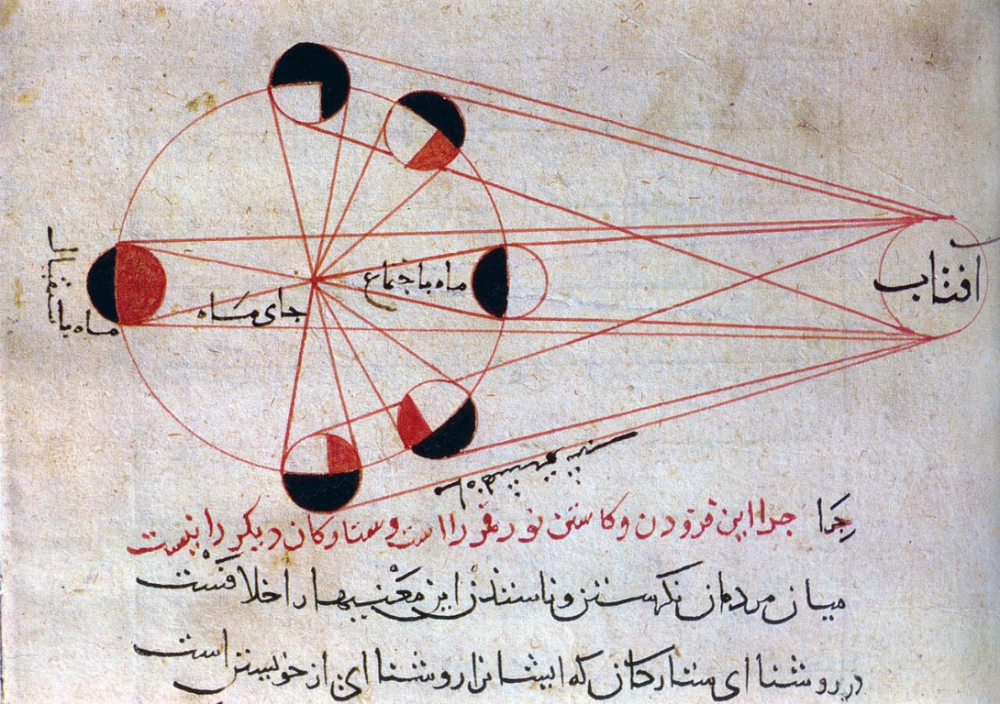

# 100 diagramas que cambiaron el mundo

## El diagrama lunar de Abu Rayhan al-Biruni (1019)

### ¿Qué es el libro?

*100 Diagrams That Changed the World*, de Scott Christianson, reúne cien diagramas, mapas, esquemas e ilustraciones que muestran cómo las representaciones visuales han contribuido a explicar y transformar nuestra comprensión del mundo. Sus ejemplos abarcan la astronomía, las matemáticas, la ciencia, la arquitectura, la medicina, la ingeniería y la tecnología.

### El diagrama de al-Biruni

La imagen corresponde a una ilustración astronómica atribuida a Abu Rayhan al-Biruni, científico, matemático y astrónomo persa que vivió aproximadamente entre los años 973 y 1048. El esquema se relaciona con su obra *Kitab al-Tafhim* y representa distintas posiciones y fases de la Luna.

### ¿Qué representa?

Mediante círculos y líneas geométricas, el diagrama muestra las relaciones entre la Tierra, la Luna y la luz solar. Las distintas posiciones ayudan a explicar los cambios de iluminación de la Luna y fenómenos relacionados, como los eclipses.

### ¿Por qué es importante?

El diagrama convierte un fenómeno astronómico difícil de observar desde distintas perspectivas en una representación visual que puede analizarse y comunicarse. En el trabajo de al-Biruni, la geometría funciona como una herramienta para estudiar y transmitir conocimiento científico.

### Importancia para el diseño

Este esquema es un ejemplo temprano de cómo un dibujo puede funcionar como diagrama: no pretende representar la Luna de manera realista, sino mostrar relaciones, posiciones y procesos. Por ello, es un antecedente de la representación visual de conceptos científicos y del diseño de información.

### Video explicativo

Se realizó un video educativo en formato vertical (9:16, 1080 × 1920), con una duración aproximada de 55 segundos. Presenta el contexto de al-Biruni, explica la relación geométrica entre el Sol, la Tierra y la Luna, recorre las fases lunares y cierra con la idea principal y la fuente.

La imagen siguiente sirve como referencia visual del diagrama lunar atribuido a al-Biruni:

**Características gráficas y de movimiento:**

- Estética inspirada en páginas de manuscritos: fondo color pergamino con textura sutil, marcos finos y tipografía serif.
- Paleta sobria de tonos marfil, tinta oscura, ocre y óxido.
- Diagramas geométricos y fases lunares estilizadas, con folios y rótulos que organizan la información.
- Textos e ilustraciones aparecen gradualmente con fundido y un leve desplazamiento vertical; el esquema orbital tiene un movimiento de rotación pausado y las fases se destacan conforme avanza la explicación.
- Las cinco escenas se suceden mediante cortes directos, sin fundidos entre escenas.

El esquema y el instrumento astronómico mostrados en el video son recreaciones gráficas educativas, no facsímiles ni objetos históricos. El esquema orbital no está a escala. Consulta el [proyecto del video](./albiruni-lunar-video/README.md) para ver la composición, la vista previa y las instrucciones de exportación.

### Idea principal

> El diagrama de al-Biruni demuestra que una imagen puede ser más que una ilustración: puede convertirse en una herramienta para pensar, explicar y transmitir conocimiento.

### Fuente

Scott Christianson, *100 Diagrams That Changed the World*.